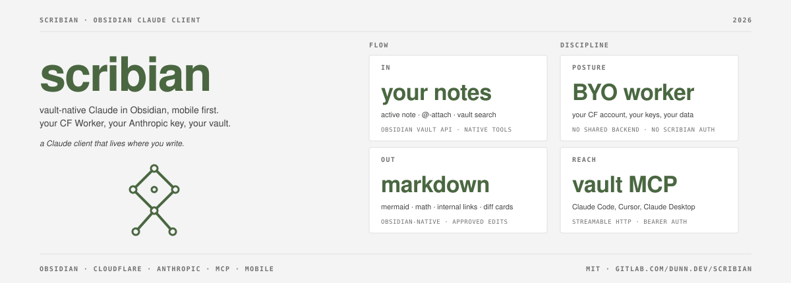

# skald

[](LICENSE)
[]()

**Mobile-first AI companion for Obsidian. Install the plugin, paste your
API key, chat. No server to deploy, nothing to host.**

skald is a Claude client that lives where you write. It streams
responses from Anthropic (or OpenRouter) directly -- no relay,
no shared backend, no account beyond your API key. Reads and writes
your vault under explicit user approval. Searches the web inline.
Conversations save back into your vault as markdown. iOS share-sheet
capture turns anything you share from another app into a
Claude-processed vault note.

> **Status:** pre-release. Feature-complete for v1 -- direct mode,
> multi-provider (Anthropic + OpenRouter), vault tools with approval,
> vault-as-memory, share-sheet capture. Awaiting the final on-device
> test pass; BRAT + community plugins listing to follow.

> **Project home:** Skald is developed on **GitLab**
> ([dunn.dev/skald.md](https://gitlab.com/dunn.dev/skald.md)) -- CI, code review,
> and the [roadmap](https://gitlab.com/dunn.dev/skald.md/-/boards) live there.
> If you are reading this on GitHub, that is a mirror for discoverability:
> issues and pull requests are welcome and get triaged onto GitLab. See
> [CONTRIBUTING.md](CONTRIBUTING.md).

Architecture decisions are recorded in [`docs/adr/`](docs/adr/).

## Quick start

### 1. Install the plugin

Today: manual install. Copy `packages/plugin/dist/{manifest.json,
main.js, styles.css}` into your vault's
`.obsidian/plugins/skald/` folder, enable the plugin in Obsidian.

See [`docs/installing-the-plugin.md`](docs/installing-the-plugin.md)
for the full path, including the upcoming BRAT route.

### 2. Add your API key

Open Obsidian -> Settings -> Skald. The four core settings:

1. **Provider** -- Anthropic (default) or OpenRouter
2. **API key** -- your `sk-ant-...` from
   [console.anthropic.com](https://console.anthropic.com/) (or your
   OpenRouter key)
3. **Default model** -- `claude-sonnet-4-6` pre-filled
4. **Memory** -- toggle on to keep a long-term memory note across
   sessions

Everything else (vault folders, personas, slash commands, capture
settings) is behind an **Advanced** expander and has safe defaults.

### 3. Chat

Open the chat pane via the speech-bubble ribbon icon or **Skald:
Open chat** from the command palette. Type a question. Watch markdown
stream in.

## What it is

Two packages in one repo:

1. **`packages/plugin/`** -- the Obsidian community plugin. Chat pane,
   markdown-rendered messages (mermaid, tables, math, internal links),
   diff-card approval for vault edits, server-side web search,
   per-conversation Anthropic / OpenRouter provider switching,
   and a long-term memory note Claude can read and propose updates to.
2. **`packages/protocol/`** -- the TypeScript wire types shared across
   the project.

## Optional companions

- Install **[Omnisearch](https://github.com/scambier/obsidian-omnisearch)** for ranked vault search -- skald uses its BM25 results automatically when it's present, falling back to a substring scan otherwise. Omnisearch is load-bearing for vault search quality; install it.

## Architecture

```
Obsidian plugin (iOS / iPad / desktop)
    |  HTTPS streaming -- anthropic-dangerous-direct-browser-access header
    v
api.anthropic.com/v1/messages    (or openrouter.ai/api/v1/messages)
```

Plugin owns conversation history. Vault tools execute locally inside
the plugin against Obsidian's Vault API. Write tools require explicit
user approval via diff card. Server-side tools (`web_search`,
`web_fetch`) run on Anthropic's infrastructure. One mode, no seams.

> **On the horizon:** the future heavy path is a self-hosted headless
> agent-host (`claude -p` / Claude Agent SDK) the phone connects to.
> Exploring, no dates. See [`docs/adr/0008-agent-host-tier.md`](docs/adr/0008-agent-host-tier.md).

## Trust model

Your Anthropic (or OpenRouter) API key lives in the plugin's
`data.json` inside your vault. People who sync their vault via
Obsidian Sync should be aware the key travels in the sync payload --
Obsidian Sync is E2EE with your sync password, but the key is plaintext
within the vault. Any other plugin you install can also read it from
the filesystem.

Mitigation: set a [spend limit](https://console.anthropic.com/settings/limits)
on the Anthropic console so a leaked key has bounded financial damage.

Full framing in [`docs/security-model.md`](docs/security-model.md).

## Develop

```sh
pnpm install

# Plugin in watch mode, writes into your dev vault
SKALD_OUT_DIR="$HOME/your-vault/.obsidian/plugins/skald" \
  pnpm dev:plugin
```

The plugin requires Hot Reload to auto-pick up changes -- install
[pjeby/hot-reload](https://github.com/pjeby/hot-reload) in your dev
vault and drop a `.hotreload` sentinel into the skald plugin folder.

## License

[MIT](LICENSE). Use, fork, ship. Attribution appreciated.
