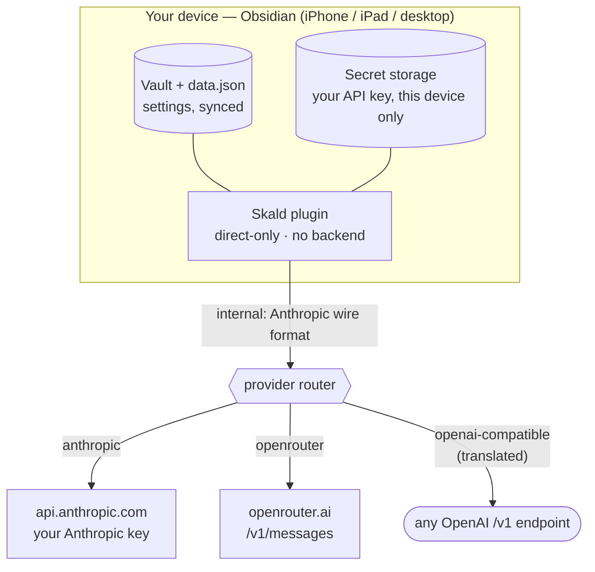

# Architecture

Skald is a **direct-only** Obsidian plugin: it talks straight from your device to
a model provider using **your** API key. There is no Skald-operated backend
([ADR 0001](adr/0001-direct-mode-over-cloudflare-worker.md)). This page orients a
reviewer — the multi-provider model, the trust
boundaries, and the test strategy.

## At a glance



## Providers (multi-API)

Skald has one internal wire format (Anthropic-shaped: content blocks, tool_use /
tool_result, SSE) and routes each turn to one of three providers:

- **anthropic** — direct to `api.anthropic.com` (the default; native server
  tools, prompt caching, citations).
- **openrouter** — OpenRouter's Anthropic-compatible `/v1/messages`, so the
  request body is unchanged.
- **openai-compatible** — translated to OpenAI's `/v1/chat/completions` shape by
  `openai-translate.ts` (request) and `openai-stream.ts` (SSE → Anthropic
  events) ([ADR 0009](adr/0009-openai-compatible-provider.md)). Point it at
  OpenAI, or at anything OpenAI-compatible, including a local server.

All three flow over the same direct HTTPS path: streaming via `fetch`
(`anthropic-dangerous-direct-browser-access`), non-streaming utility calls via
Obsidian's `requestUrl` (which bypasses CORS).

## Trust boundaries

Two places untrusted data enters; both are validated at a single chokepoint:

1. **Vault paths from AI tool calls** → `safePath()` (`tools/context.ts`) — the
   sole guard against traversal/escape into the vault filesystem. Tested in
   `tools/context.test.ts` (mutation-verified).
2. **`data.json`** (operator-editable *and* Obsidian-Sync-delivered) →
   `normalizeSettings()` (`settings-normalize.ts`) coerces an unknown provider,
   clamps an insecure base URL, and drops malformed and unknown fields. No API
   key crosses it: `data.json` names each key's secret, and `api-keys.ts` reads
   the key from secret storage when a request needs it.

## Test strategy

- The **pure core** (transport, providers, parsers, tool logic) is unit-tested
  with a **coverage floor** (`vitest.config.ts` thresholds; ~84% lines,
  ratcheting toward 90%) plus **Stryker mutation testing** on the wire parsers.
- The **Obsidian-DOM `view/` layer** is covered by the e2e suite, not unit
  tests — vitest runs in a `node` env with no DOM — so it is excluded from the
  coverage floor by design.

## Verify

```
pnpm check          # typecheck + tests + 400-line size cap + plugin-lint + build
pnpm test:coverage  # the core coverage floor
pnpm test:mutation  # Stryker on the parsers (also a nightly CI job)
```
